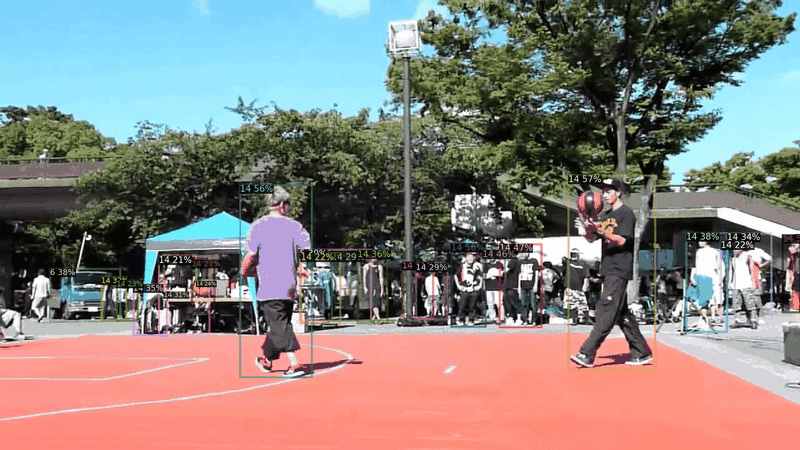
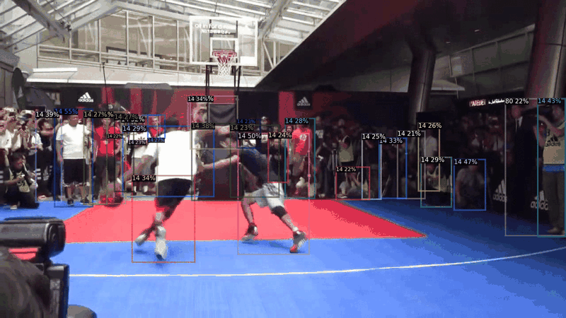
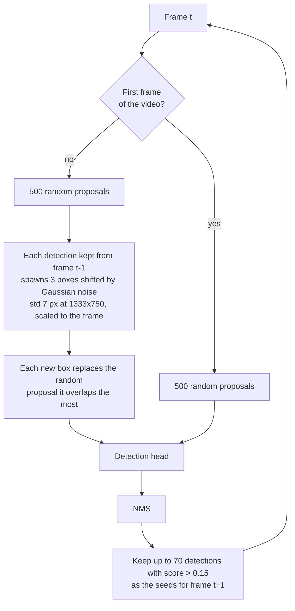
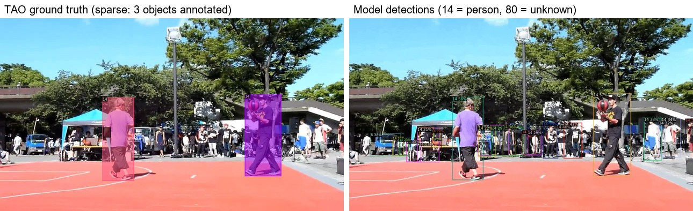

# TA-RandBox: temporal random proposals for open-world object detection in video

**Detect objects nobody labelled, in video, at a fraction of the cost.** TA-RandBox extends
[RandBox](https://github.com/Yanghao-Wang/RandBox) (ICCV 2023), an open-world detector trained on random region
proposals, to video streams. Instead of drawing fresh proposals for every frame, it re-seeds part of the proposal
budget around the previous frame's detections and keeps the rest random to explore for new, possibly unknown,
objects.

On TAO-LaSOT it matches the known-class accuracy of RandBox's 10,000-proposal inference with 500 proposals,
**~9x faster per frame**, with the best unknown-object F1 and the fewest open-set errors among the methods compared.

Bachelor's thesis in Telecommunication Engineering at the University of the Basque Country (UPV/EHU), carried out
at [TECNALIA](https://www.tecnalia.com) (2023-2024), with follow-up results presented at TECNALIA in 2025.

<p align="center">
  
  
</p>

> **Status (2026).** This repository was cleaned up two years after the thesis. The model and the temporal-proposal
> heuristic are the original code. The video evaluation loop and the TAO preparation lived in a modified Detectron2
> on a TECNALIA server that is no longer available, so they were **rebuilt** from the thesis, the experiment log in
> [`results/logs/`](results/logs/) and the compiled files left in the original repository. The tables below are the
> **reported** results; re-running them with this code is in progress and will be added next to them.

## What is new here, and what is RandBox

| | Source |
|---|---|
| Open-world detector trained on random proposals, matching score, losses, image OWOD training/evaluation | [RandBox](https://github.com/Yanghao-Wang/RandBox) (Wang et al., ICCV 2023), built on [DiffusionDet](https://github.com/ShoufaChen/DiffusionDet) and [Sparse R-CNN](https://github.com/PeizeSun/SparseR-CNN) |
| **Temporal proposals for video** (`RandBox.temporal_proposals`, `MODEL.RandBox.TEMPORAL`) | this work |
| **Open-world evaluation on TAO video frames** (frame index, label mapping to the OWOD classes, per-video inference loop, U-PRE / U-F1 / Tq) | this work |

The weights are RandBox's released task-1 model (20 known PASCAL VOC classes, trained on PASCAL VOC + COCO). The
temporal heuristic changes inference only: no retraining.

## Method

RandBox replaces the region proposal network with random boxes, which removes the bias towards the classes seen in
training and lets it find unknown objects. At inference, though, its default is a fixed grid of 10,000 boxes per
image: accurate but ~10x slower than 500 random boxes, and wasteful on video, where consecutive frames are almost the
same.

TA-RandBox exploits that temporal correlation:



At most 70 x 3 = 210 proposals follow already-detected objects, and at least 290 stay random, so the model keeps
exploring the frame for new objects. Following the detections with 210 boxes beat 1,800 purely random boxes in the
thesis: the temporal boxes are worth far more than their number.

## Results

### TAO video subsets (reported, follow-up talk 2025)

Task-1 model (20 known classes) evaluated on the annotated frames of the TAO training videos, every frame of each
video processed in order. K-mAP: mAP@0.5 over the known classes present in the subset; U-PRE / U-REC / U-F1:
precision, recall and F1 of the *unknown* class; A-OSE: unknown objects detected as a known class; WI: Wilderness
Impact at recall 0.8; Tq: seconds per frame.

**LaSOT** (14 of the 20 known classes annotated, ~4,000 annotated frames out of ~120,000):

| Method | K-mAP ↑ | U-PRE ↑ | U-REC ↑ | U-F1 ↑ | A-OSE ↓ | WI ↓ | Tq (s) ↓ |
|---|---:|---:|---:|---:|---:|---:|---:|
| ORE | 38.58 | **19.21** | 6.62 | 9.58 | 5291 | 0.192 | 0.096 |
| UnSniffer | 41.94 | 6.55 | **46.95** | 11.50 | 6790 | 0.121 | 0.233 |
| RandBox, 10k proposals | **42.32** | 11.58 | 44.83 | 18.41 | 3541 | **0.071** | 0.597 |
| RandBox, 500 random | 39.42 | 16.65 | 38.87 | 23.31 | 3019 | 0.094 | **0.058** |
| **TA-RandBox (500)** | 42.26 | 17.66 | 38.87 | **24.29** | **2925** | 0.111 | 0.067 |

<details>
<summary>ArgoVerse, BDD, Charades and YFCC100M</summary>

These subsets annotate only 6-7 of the 20 known classes and far fewer frames, and some have low resolution, so the
known-class numbers are low and noisy for every method; TA-RandBox's gains there are small or absent (it trails
500 random boxes on K-mAP in ArgoVerse and BDD).

| Subset | Method | K-mAP | U-PRE | U-REC | U-F1 | A-OSE | WI | Tq (s) |
|---|---|---:|---:|---:|---:|---:|---:|---:|
| ArgoVerse | ORE | 24.42 | 2.15 | 2.80 | 2.43 | 952 | 0.114 | 0.199 |
| | UnSniffer | 26.08 | 2.52 | 25.60 | 4.59 | 230 | 0.093 | 0.320 |
| | RandBox-10k | 26.10 | 2.49 | 48.00 | 4.73 | 176 | 0.017 | 0.727 |
| | RandBox-500 | 27.36 | 3.34 | 40.40 | 6.17 | 154 | 0.021 | 0.060 |
| | TA-RandBox | 25.50 | 3.49 | 41.60 | 6.44 | 161 | 0.022 | 0.057 |
| BDD | ORE | 9.08 | 7.32 | 6.45 | 6.86 | 2501 | 0.098 | 0.179 |
| | UnSniffer | 12.63 | 1.17 | 70.09 | 2.30 | 749 | 0.015 | 0.490 |
| | RandBox-10k | 10.04 | 2.99 | 53.96 | 5.67 | 513 | 0.012 | 0.609 |
| | RandBox-500 | 10.10 | 3.71 | 40.91 | 6.80 | 470 | 0.020 | 0.063 |
| | TA-RandBox | 9.25 | 3.92 | 42.08 | 7.17 | 785 | 0.020 | 0.045 |
| Charades | ORE | 15.64 | 3.40 | 0.24 | 0.45 | 2967 | 0.176 | 0.079 |
| | UnSniffer | 16.46 | 3.46 | 16.47 | 5.72 | 1389 | 0.057 | 0.282 |
| | RandBox-10k | 18.15 | 4.86 | 12.83 | 7.05 | 785 | 0.041 | 0.576 |
| | RandBox-500 | 12.37 | 5.11 | 8.74 | 6.45 | 509 | 0.044 | 0.058 |
| | TA-RandBox | 15.50 | 5.25 | 9.21 | 6.69 | 538 | 0.045 | 0.054 |
| YFCC100M | ORE | 36.69 | 7.33 | 1.00 | 1.76 | 3766 | 0.302 | 0.134 |
| | UnSniffer | 40.08 | 1.17 | 19.18 | 2.21 | 381 | 0.005 | 0.198 |
| | RandBox-10k | 41.23 | 2.12 | 19.09 | 3.82 | 254 | 0.002 | 0.558 |
| | RandBox-500 | 40.34 | 2.87 | 16.09 | 4.87 | 203 | 0.002 | 0.052 |
| | TA-RandBox | 40.98 | 2.85 | 16.36 | 4.85 | 215 | 0.002 | 0.052 |

</details>

The RandBox and TA-RandBox rows were produced with the original version of this evaluator (the RandBox-500 LaSOT
row matches the log in [`results/logs/`](results/logs/lasot_random500_eval.log)). The ORE and UnSniffer rows come
from the same study; the code used to run those two baselines is not part of this repository.

**Why TAO scores look low.** TAO annotates one frame per second and, in each, only some objects (left: the ground
truth of a LaSOT frame; right: what the model finds). Detections of unannotated objects count as false positives, so
absolute precision understates the model; the comparison between methods on the same frames is what matters.

<p align="center"></p>

### Images: PASCAL VOC + COCO, task 1 (reported, thesis)

Reproduction of RandBox's released model (4,952 test images, 2 GPUs). The gap between the two inference modes is
what motivates the temporal proposals:

| Inference | K-mAP | U-R | WI | A-OSE | Time |
|---|---:|---:|---:|---:|---:|
| RandBox, 10k grid (default) | 61.74 | 10.56 | 0.024 | 4498 | 45 min |
| RandBox, 500 random | 60.20 | 8.31 | 0.035 | 2938 | 4 min |

## Getting started

Tested environment of the original experiments: Linux, Python 3.10, PyTorch 2.1.0 + CUDA 12.1, Detectron2 0.6.
A Colab notebook that installs everything and runs a quick check is in
[`notebooks/colab_quickstart.ipynb`](notebooks/colab_quickstart.ipynb).

```bash
pip install torch==2.1.0 torchvision==0.16.0 --index-url https://download.pytorch.org/whl/cu121
pip install --no-build-isolation 'git+https://github.com/facebookresearch/detectron2.git'  # builds against your torch
pip install -r requirements.txt
```

**Weights.** Download RandBox's task-1 model from the
[RandBox README](https://github.com/Yanghao-Wang/RandBox#models) to `models/randbox_t1.pth`.

**Data.** Download TAO (frames and annotations) from [taodataset.org](https://taodataset.org) into `datasets/tao/`
(`frames/train/<source>/<video>/` and `annotations/train.json`). For the image experiments, follow RandBox's
[getting started](https://github.com/Yanghao-Wang/RandBox/blob/main/GETTING_STARTED.md) (`datasets/t1/...`).

**Evaluate on a TAO subset** (builds the frame index, then runs the three inference methods):

```bash
bash scripts/eval_tao.sh LaSOT models/randbox_t1.pth
```

or one method at a time, optionally on the first videos only for a quick check:

```bash
python tools/prepare_tao.py --tao-root datasets/tao --subsets LaSOT --out datasets/tao/frames_lasot.pkl
python tools/eval_tao.py --config-file configs/t1.yaml --frames datasets/tao/frames_lasot.pkl \
    --method ta-randbox --max-videos 5 MODEL.WEIGHTS models/randbox_t1.pth OUTPUT_DIR output/lasot_ta
```

**Run on your own video:**

```bash
python tools/demo_video.py --input clip.mp4 --output clip_detections.mp4 --method ta-randbox \
    MODEL.WEIGHTS models/randbox_t1.pth
```

**Image OWOD (RandBox's own pipeline):** `scripts/eval_owod.sh`, `scripts/train_owod.sh`.

## Repository layout

```
randbox/
  detector.py              RandBox + temporal proposals (temporal_proposals, MODEL.RandBox.TEMPORAL)
  video_inference.py       frame-by-frame inference over videos, carrying the proposals between frames
  tao_owod_evaluation.py   open-world metrics on TAO frames (K-mAP, U-PRE/REC/F1, A-OSE, WI)
  config.py                RandBox config + TEMPORAL options
  ...                      head, losses, mapper, backbones (RandBox)
tools/
  prepare_tao.py           TAO -> frame index with OWOD labels
  eval_tao.py              evaluate a method on a TAO subset
  demo_video.py            detections on a video file
  train_net.py             RandBox image training / evaluation
configs/                   RandBox task configs (t1 ... t4_ft)
split/                     OWOD image splits (RandBox)
results/logs/              log of the original RandBox-500 run on LaSOT (2024)
```

## Notes on the evaluation

- Every frame of a video is run (the temporal proposals need them), but only annotated frames are scored.
- `tools/prepare_tao.py --label-mapping thesis` (default) reproduces the label mapping used for the reported
  results. In it, a TAO category without a COCO equivalent is looked up in the COCO -> OWOD table by its raw id, so
  a few non-COCO categories with ids below 80 become known classes instead of "unknown". `--label-mapping fixed`
  corrects this; its numbers are not comparable with the tables above.
- Known classes with no annotation in a subset are left out of K-mAP when the model detects them (their AP is
  undefined); a known class with neither annotations nor detections counts as AP 0, as in the original evaluator.

## Citation

```bibtex
@thesis{olivares2024tarandbox,
  author = {Olivares Rad, Aitzol},
  title  = {Nuevos modelos de detecci{\'o}n de objetos en flujos de v{\'i}deo basados en la aleatorizaci{\'o}n de
            propuestas de regiones de inter{\'e}s y Aprendizaje Profundo},
  school = {University of the Basque Country (UPV/EHU)},
  type   = {Bachelor's thesis},
  year   = {2024}
}

@inproceedings{wang2023randbox,
  author    = {Wang, Yanghao and Yue, Zhongqi and Hua, Xian-Sheng and Zhang, Hanwang},
  title     = {Random Boxes Are Open-world Object Detectors},
  booktitle = {ICCV},
  year      = {2023},
  pages     = {6233-6243}
}
```

## Acknowledgements and license

Thesis supervised by Miren Nekane Bilbao (UPV/EHU) and carried out at TECNALIA. Built on
[RandBox](https://github.com/Yanghao-Wang/RandBox), [DiffusionDet](https://github.com/ShoufaChen/DiffusionDet),
[Sparse R-CNN](https://github.com/PeizeSun/SparseR-CNN) and [Detectron2](https://github.com/facebookresearch/detectron2);
see [NOTICE.md](NOTICE.md) for what comes from where and under which terms.
